<div align="center">

# 🎯 HireSync — Unified Recruitment Platform

**One backend. Two hiring worlds. Zero missed opportunities.**

[](https://nodejs.org/)
[](https://expressjs.com/)
[](https://www.mongodb.com/)
[](https://redis.io/)
[](https://socket.io/)
[](#license)

[Features](#-features) • [Architecture](#-architecture) • [Tech Stack](#-tech-stack) • [Installation](#-installation) • [API Docs](#-documentation) • [Highlights](#-project-highlights)

</div>

<div align="center">

| 63+ | 4 | 10 | 12 | 13 |
|:---:|:---:|:---:|:---:|:---:|
| REST Endpoints | User Roles | MongoDB Models | Route Modules | Controllers |

*(counted directly from the codebase — see [Project Highlights](#-project-highlights))*

</div>

---

## The Problem

Imagine this: you're a final-year student. You have 12 browser tabs open — Internshala, LinkedIn, Naukri, your college portal, three WhatsApp groups, and a Gmail inbox with 847 unread emails. Somewhere in that chaos is your dream placement opportunity. You'll probably never see it.

```
❌  Off-campus opportunities scattered across 10+ platforms
❌  On-campus drives buried inside Gmail — unseen, missed
❌  No unified view of what's available, what you applied to
❌  TPOs manually emailing spreadsheets and tracking responses by hand
❌  Recruiters scrolling hundreds of resumes with no way to rank them
```

**HireSync** is the backend for a platform that fixes this: one system that runs a college's *on-campus* placement drives and a company's *off-campus* hiring pipeline side by side, with real-time updates, automatic resume-to-skill matching, and zero manual spreadsheet-chasing.

```
✅  One platform. Every opportunity. Zero missed updates.
```

---

## 📖 Overview

HireSync is a **production-style REST API** for campus & off-campus recruitment, built with **Node.js, Express 5, and MongoDB**.

| World | Flow |
|---|---|
| **Off-campus** | Recruiters post jobs → candidates self-register (email OTP verified) → upload a resume (skills auto-extracted from the PDF) → get skill-matched job recommendations → apply → get real-time accept/reject notifications. |
| **On-campus** | A TPO registers their college → an admin verifies it → the TPO bulk-imports students from an Excel/CSV sheet → organizes them into placement groups → posts a campus drive targeted at a group (or the whole college) → students respond before a deadline → the TPO downloads a PDF report and views placement analytics. |

It was built incrementally across six phases — starting from core auth/jobs/applications, layering in validation and resume parsing, then a skill-matching recommendation engine, a full campus placement module with real-time notifications, analytics for both sides, and finally a manually-managed placement-group system built *on top of* the original group model without breaking a single existing route.

---

## 📸 Screenshots

*Live deployment — deployed frontend + this backend, connected end-to-end.*

### Dashboards

| Recruiter Dashboard | TPO / Placement Cell Dashboard |
|---|---|
| 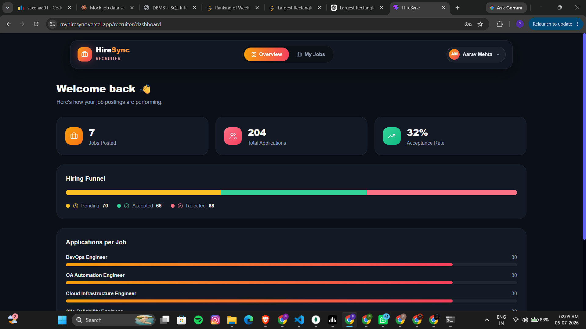 | 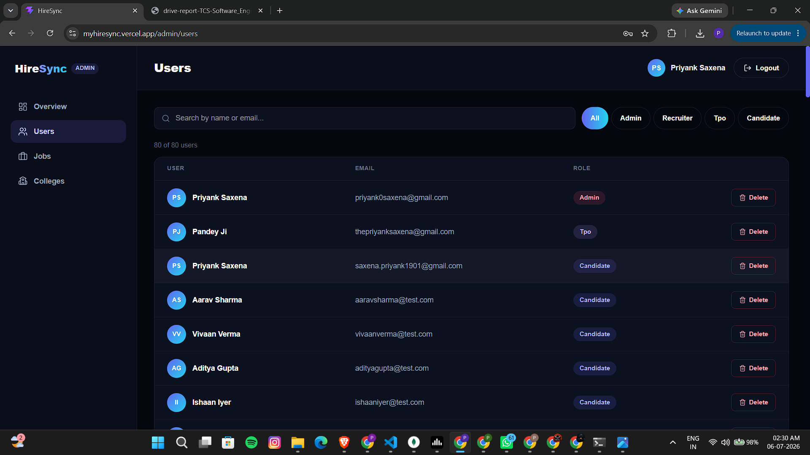 |

<div align="center">
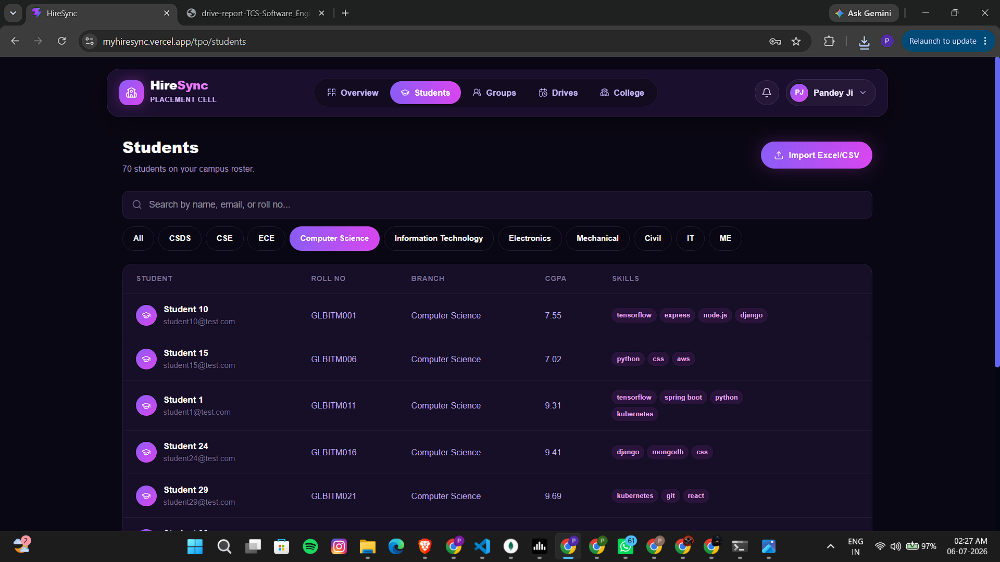
<br/><em>Candidate Dashboard</em>
</div>

### Off-Campus Flow

| Recruiter — My Jobs | Candidate — Browse Jobs |
|---|---|
| 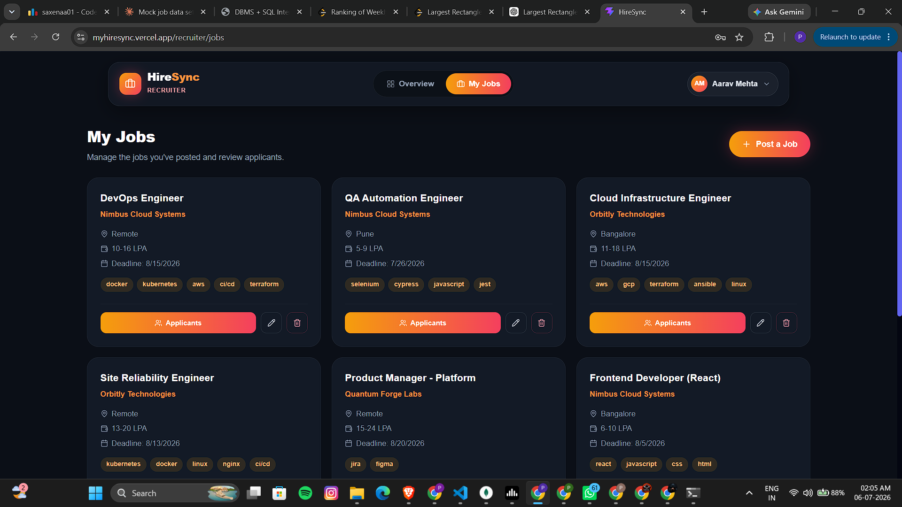 | 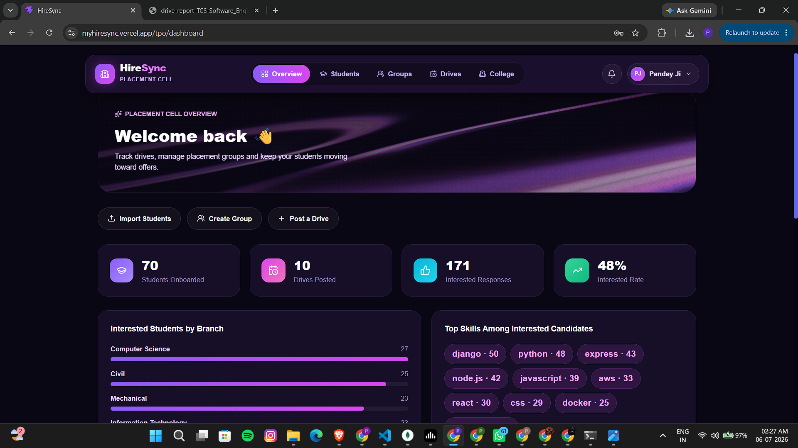 |

<div align="center">
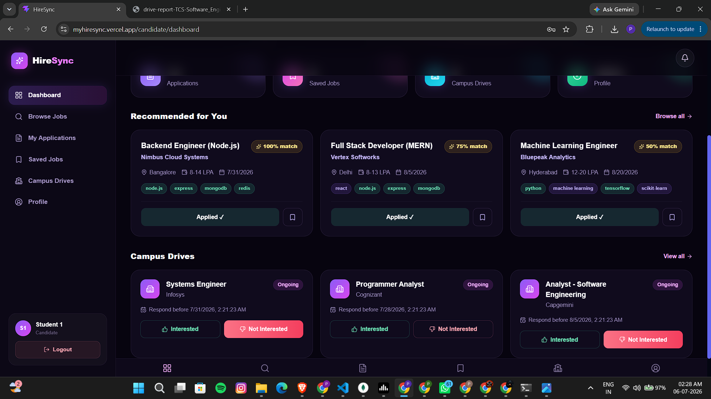
<br/><em>My Applications — live status tracking (Pending / Accepted / Rejected)</em>
</div>

### On-Campus Flow

| Campus Drives (Candidate View) | TPO — Student Roster |
|---|---|
| 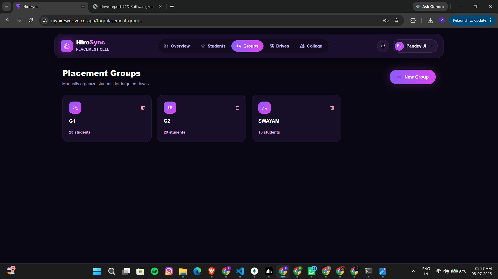 | 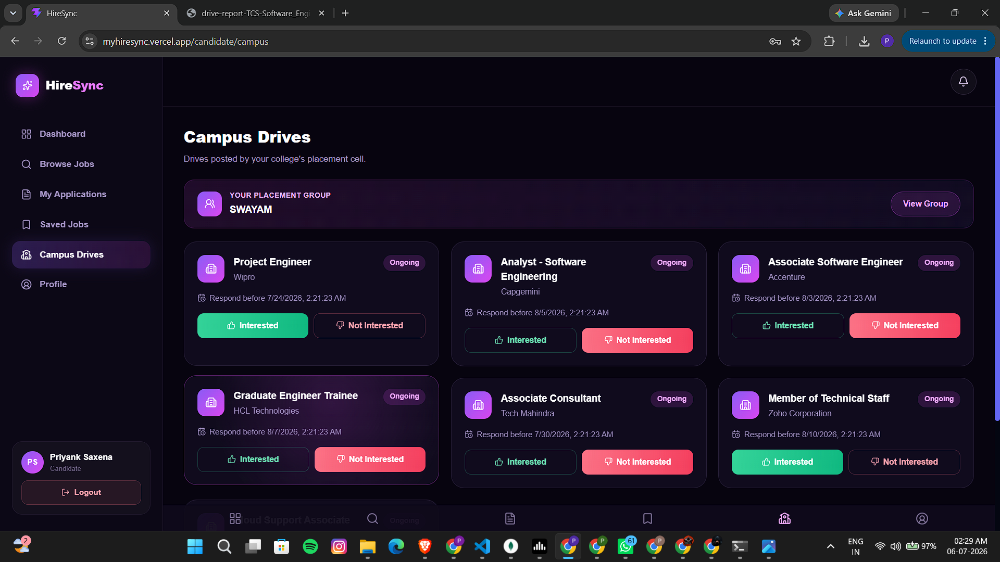 |

| Placement Groups | Generated Drive Report (PDF) |
|---|---|
| 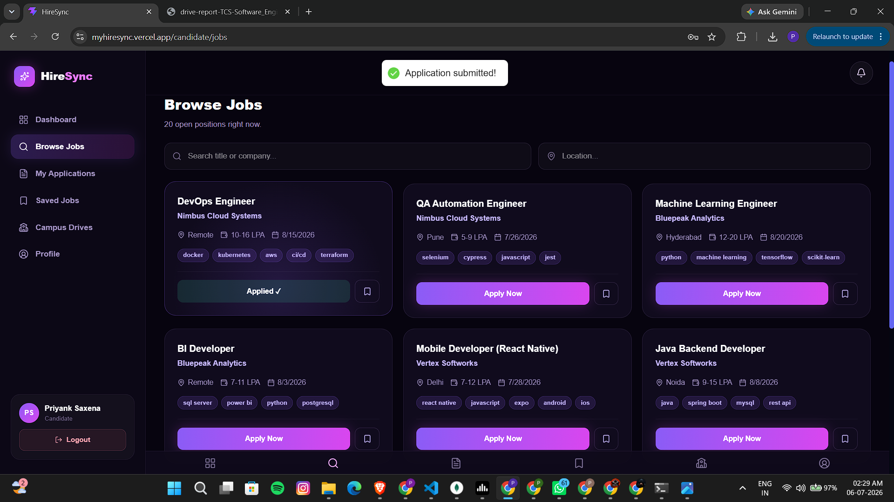 | 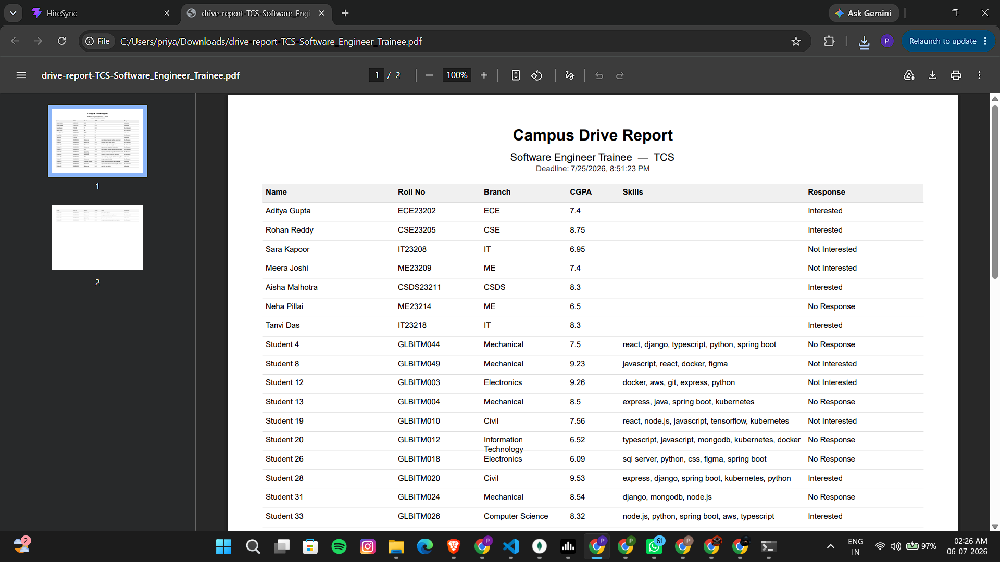 |

### Admin

<div align="center">
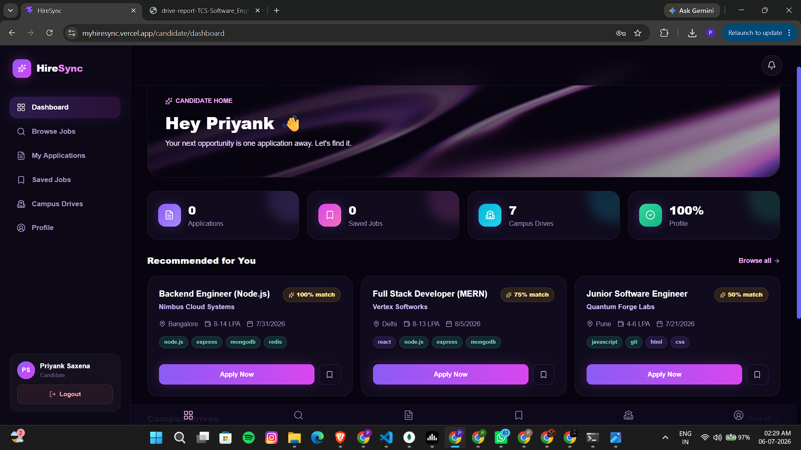
<br/><em>Admin Panel — role-based user management across all four roles</em>
</div>

---

## ✨ Features

### 🔓 Auth & Security
- **Email-OTP-gated registration** — a 6-digit code (bcrypt-hashed at rest, 10-minute TTL, 60s resend cooldown) must be verified before an account can be created.
- **Role-based JWT auth** via `httpOnly` cookies — four roles (`candidate`, `recruiter`, `admin`, `tpo`), each with dedicated middleware guards.
- **Live account revocation** — every authenticated request re-checks that the user still exists, so a deleted account is locked out immediately instead of riding out its token's lifetime.
- **Global error handler** normalizes Mongoose validation errors, duplicate-key (`11000`) conflicts, JWT errors, and Multer upload errors into consistent JSON responses.

### 🧠 Skill Matching Engine
- One shared `matchScore()` utility powers **both directions**: candidates get ranked job recommendations, recruiters get a ranked shortlist of candidates for a job — same algorithm, same guarantees, no drift between the two.
- **Automatic resume parsing** — upload a PDF, text is extracted server-side, and skills are matched against a curated list of 150+ technologies using word-boundary regex (so `"java"` never falsely matches inside `"javascript"`).

### 🏫 Campus Placement Workflow
A full pipeline modeled on how a real TPO office runs a placement season:
1. **College onboarding** — TPO registers a college, starts unverified.
2. **Admin verification** — gatekeeps every downstream TPO action.
3. **Bulk student import** — Excel/CSV upload, tolerant of header-casing variance, dedupes by roll number, links pre-existing accounts instead of duplicating them, and emails temporary credentials in throttled batches.
4. **Two group models, on purpose** — legacy filter-based `StudentGroup`s (auto-populated by CGPA / branch / skills) coexist with manually-managed `PlacementGroup`s (**one group per student**, TPO-controlled) — old drives keep working, new ones get precise manual targeting.
5. **Campus drives** — targeted at `all`, a `studentGroup`, or one/more `placementGroup`s, with an auto-computed **effective status** (`closed` the instant the deadline passes, regardless of what's stored).
6. **Student response** — interested / not interested, one response per student per drive (DB-enforced unique index).
7. **PDF drive reports** — generated on-the-fly with `pdfkit`, paginated, landscape A4, streamed directly to the response.
8. **Placement analytics** — response rates and funnel breakdowns for the TPO dashboard.

### ⚡ Real-Time Notifications
- **Socket.IO**, authenticated with the same JWT as the REST API (via handshake token or cookie) — no separate auth system to maintain.
- Personal rooms (`user:<id>`) for direct events (application status, drive-response confirmation) and college-wide rooms (`college:<id>`) for drive announcements.
- Every socket event is **backed by a persisted `Notification` document**, so nothing is lost if the client was offline when it fired.

### 🚀 Transparent Redis Caching
- A single `cache(keyBuilder, ttl)` middleware wraps hot GET routes (job listings, job detail, recommendations, campus drive feed) — cache hits/misses are visible via an `X-Cache: HIT|MISS` response header.
- **Fails open** — if Redis is down, `isRedisReady()` short-circuits every cache/invalidate call and the API behaves exactly as if caching didn't exist. No crash, no blocking, no special-casing needed elsewhere in the code.
- **Precise invalidation** — a job edit busts only `jobs:item:<id>` + list/recommendation keys; a single student's group re-assignment busts *only that student's* cached campus feed, not the whole college's.

### 📊 Analytics
- **Recruiter dashboard** — jobs posted, total applications, a full pending/accepted/rejected funnel, acceptance rate, and a per-job breakdown.
- **TPO dashboard** — placement-drive engagement and response analytics per college.

### ✅ Defensive by Default
- `asyncHandler` wraps every controller so a rejected promise never crashes the process silently.
- `express-validator` field-level validation on every write route, with a single `validate` middleware producing a consistent `{ field, message }[]` error shape.
- Multer file-type/size guards (5MB PDF for resumes, 10MB Excel/CSV for imports) with friendly rejection messages.

---

## 🏗 Architecture

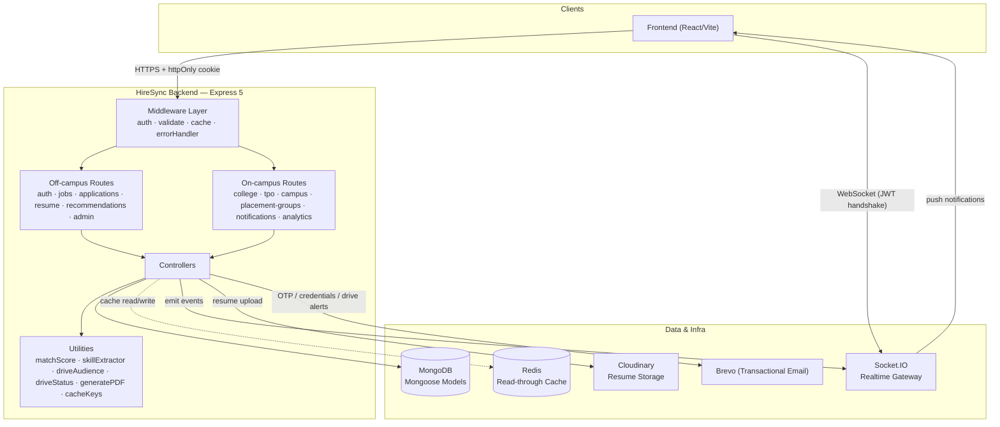

**Request lifecycle (a cached job list, for example):**

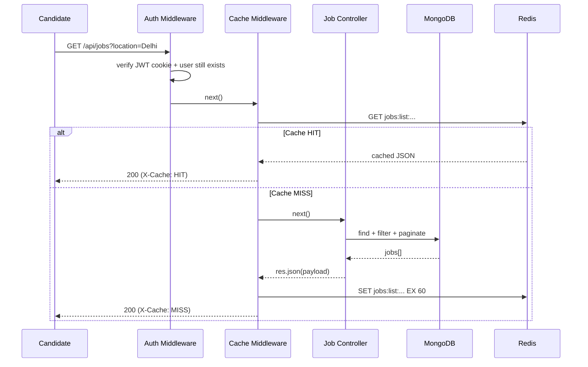

---

## 🧰 Tech Stack

| Layer | Technology |
|---|---|
| Runtime | Node.js |
| Framework | Express 5 |
| Database | MongoDB + Mongoose |
| Auth | JSON Web Tokens (httpOnly cookies) + bcryptjs |
| Validation | express-validator |
| Caching | Redis (`ioredis`) — read-through cache, fails open |
| Realtime | Socket.IO (JWT-authenticated sockets) |
| File Uploads | Multer (in-memory buffers) |
| Resume Storage | Cloudinary |
| PDF Parsing | `pdf-parse` (resume text extraction) |
| PDF Generation | `pdfkit` (drive reports) |
| Spreadsheet Parsing | `xlsx` (student import) |
| Transactional Email | Brevo (`sib-api-v3-sdk`) |
| Dev Tooling | nodemon |

---

## 🔩 Major Engineering Features

These are the design decisions worth a reviewer's second look:

- **Fail-open infrastructure everywhere.** Redis down? Caching silently becomes a no-op. Email fails mid-registration? The dangling OTP record is cleaned up and a real error is returned instead of an orphaned state. The API degrades gracefully instead of cascading failures.
- **One matching algorithm, two consumers.** `matchScore()` is the single source of truth for skill compatibility — reused unmodified for candidate→job recommendations and recruiter→candidate shortlists.
- **Backward-compatible data model evolution.** `PlacementGroup` (manual, one-per-student) was added *after* `StudentGroup` (filter-based, many-to-many) was already in production use. Both targeting modes are still valid on a `CampusDrive` today (`targetType: studentGroup | placementGroup | all`), so nothing that shipped in an earlier phase had to be migrated or broken.
- **Auto-computed drive status.** A drive's `status` field can lag reality — `effectiveStatus()` recalculates `closed` the instant `deadline` passes, so there's no cron job needed to keep drives in sync.
- **Precise cache invalidation, not blunt flushing.** Cache keys are namespaced per college *and* per user (`campus:drives:<collegeId>:<userId>`), so moving one student between placement groups busts exactly one cached feed — not the entire college's.
- **Idempotent, tolerant bulk import.** The Excel importer accepts header-casing variance (`Roll No` / `rollNo` / `ROLL_NO`), de-duplicates by roll number within the sheet, and links (rather than duplicates) any student whose email already exists — while queuing credential emails in throttled batches of 50 via `Promise.allSettled` so one bad address never blocks the rest.
- **Unified realtime + persisted notifications.** Every Socket.IO emit (`drive:new`, `application:status`, `drive:response:confirmed`, …) is paired with a `Notification` document, so a candidate who was offline still sees it the next time they check their inbox.

---

## 📦 Installation

```bash
# clone
git clone https://github.com/<your-username>/hiresync-backend.git
cd hiresync-backend

# install dependencies
npm install

# configure environment
cp .env.example .env
# fill in the values described below

# run in development (auto-restart via nodemon)
npm run dev

# or run in production
npm start
```

The server boots on `PORT` (default `3000`), connects to MongoDB immediately, and attempts a Redis connection that never blocks startup even if Redis is unreachable.

---

## 🔑 Environment Variables

| Variable | Required | Notes |
|---|---|---|
| `PORT` | no | Defaults to `3000` |
| `MONGO_URI` | **yes** | MongoDB connection string |
| `JWT_SECRET` | **yes** | Signs the auth cookie / socket handshake token |
| `CLIENT_URL` | no | Frontend origin for CORS + Socket.IO (defaults to `http://localhost:5173`) |
| `REDIS_URL` | no | If unreachable, caching simply no-ops — the app still runs |
| `BREVO_API_KEY` | for emails | Transactional email API key (OTP, credentials, drive alerts) |
| `EMAIL_FROM` | for emails | Sender address shown to recipients |
| `CLOUDINARY_CLOUD_NAME` / `CLOUDINARY_API_KEY` / `CLOUDINARY_API_SECRET` | for resume upload | Cloudinary credentials |

---

## 🗂 Folder Structure

```
Hiresync-backend/
├── server.js                    # entrypoint — HTTP server + Socket.IO + Mongo/Redis bootstrap
├── src/
│   ├── app.js                   # Express app, middleware & route wiring
│   ├── config/
│   │   ├── cloudinary.js        # Cloudinary SDK config
│   │   ├── multer.js            # PDF + Excel/CSV upload handlers (in-memory)
│   │   ├── redis.js             # Fail-open Redis client
│   │   └── socket.js            # JWT-authenticated Socket.IO gateway
│   ├── controllers/             # 13 controllers — one per domain
│   ├── db/
│   │   └── db.js                # Mongoose connection
│   ├── middlewares/
│   │   ├── auth.middleware.js    # authCandidate / authRecruiter / authAdmin / authTPO / authUser
│   │   ├── cache.middleware.js   # transparent read-through cache
│   │   ├── errorHandler.js       # asyncHandler + global error normalizer
│   │   └── validate.js          # express-validator result handler
│   ├── models/                  # 10 Mongoose schemas
│   ├── routes/                  # 13 route files, mounted in app.js
│   ├── utils/
│   │   ├── cacheKeys.js         # centralised key builders + invalidators
│   │   ├── driveAudience.js     # single source of truth for "who sees this drive"
│   │   ├── driveStatus.js       # auto-computed effective drive status
│   │   ├── generatePDF.js       # streamed PDF drive-report generator
│   │   ├── matchScore.js        # bidirectional skill-matching algorithm
│   │   ├── sendEmail.js         # single + batched transactional email
│   │   └── skillExtractor.js    # regex skill extraction against a 150+ term list
│   └── validators/               # express-validator rule sets per domain
├── package.json
└── .env.example
```

---

## 👥 Roles & Access

| Role | Capabilities |
|---|---|
| `admin` | Verify colleges, manage/delete users, view all jobs |
| `tpo` | Owns exactly one college (once verified): import students, manage groups & placement groups, run campus drives, view analytics |
| `recruiter` | Post/manage off-campus jobs, review applicants, view hiring-funnel analytics |
| `candidate` | Self-registered (off-campus) or imported (on-campus): browse/apply to jobs, respond to campus drives, upload resume, get recommendations |

---

## 🏆 Project Highlights

- **63+ REST endpoints across 12 route modules, 13 controllers, and 10 data models** — a genuinely full-featured recruitment platform, not a CRUD toy.
- **Two independent hiring pipelines sharing one codebase** — off-campus job-board flow and on-campus campus-drive flow reuse the same auth, notification, and caching infrastructure without stepping on each other.
- **Real-time, not polling** — Socket.IO events fire the moment a drive is posted or an application status changes.
- **Designed to survive partial outages** — Redis, email, and even individual rows in a bulk import can fail without taking the rest of the request (or the app) down with them.
- **Six incremental phases, zero breaking migrations** — every new feature (recommendations, campus module, analytics, placement groups) was added without altering the contract of a route that shipped earlier.

---

## 📚 Documentation

- **[API Guide](docs/API_GUIDE.md)** — every endpoint, grouped by domain, with method, access role, and validation notes.
- **[Architecture Guide](docs/ARCHITECTURE.md)** — deeper dive into the caching strategy, the drive-targeting model, and the notification pipeline.

---

## License

ISC