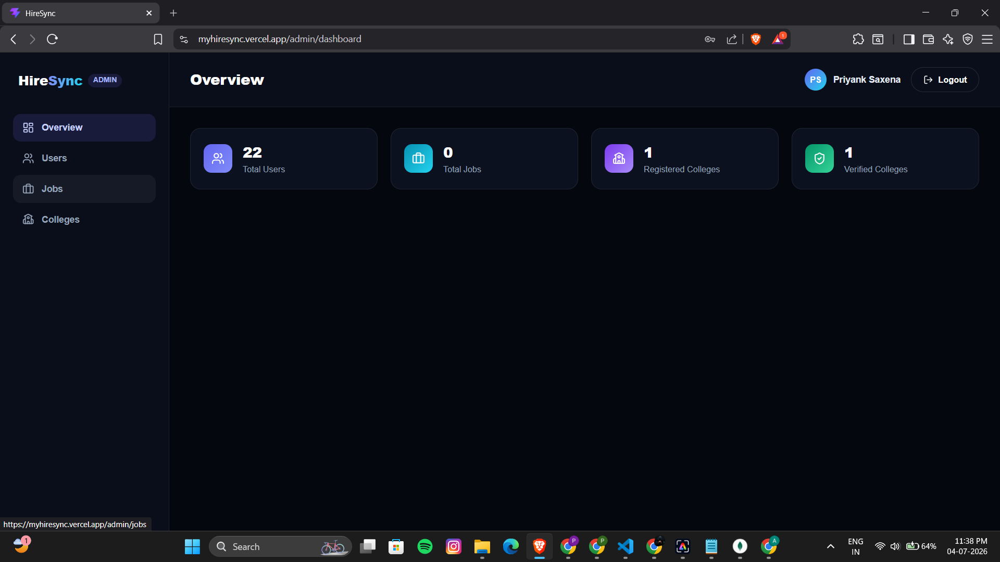
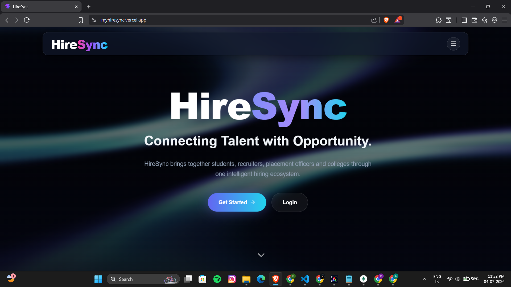
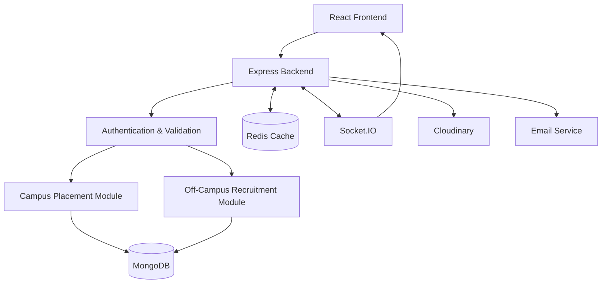

 <div align="center">

# 🎯 HireSync

### Unified Recruitment & Campus Placement Platform

**Less manual work for TPOs. Fewer missed opportunities for students. Better hiring for recruiters.**

A real-world project inspired by placement challenges I observed at my own college, designed to simplify campus recruitment and off-campus job hunting for students and colleges.

<br/>


<br/><br/>

[Features](#-features) • [Tech Stack](#-tech-stack) • [Architecture](#-architecture) • [Getting Started](#-getting-started)

</div>

---

## 💡 Why I Built HireSync

Placement season can become stressful for both students and Training and Placement Officers (TPOs).

<div align="center">

| 🎓 For Students | 🏫 For TPOs | 💼 For Recruiters |
|:---:|:---:|:---:|
| Opportunities scattered across platforms | Manual student and drive management | Time-consuming resume screening |
| Important updates get missed | Spreadsheet-based tracking | Difficult candidate shortlisting |
| Hard to track applications and drives | Difficult to monitor student responses | Limited hiring analytics |

</div>

### ✨ My Solution

HireSync brings campus placements and off-campus recruitment into one platform.

- 🎓 Students can discover jobs, apply, upload resumes, and respond to campus drives.
- 🏫 TPOs can manage students, organize placement groups, create drives, and track responses.
- 💼 Recruiters can post jobs, review candidates, and use skill-based matching.
- 🔔 Users receive real-time notifications about important updates.

**The goal:** Reduce placement-related headaches and make opportunities easier to manage and access.

---

## ✨ Features

<table>
<tr>
<td width="50%">

### 🏫 Campus Placement Management

- College registration and verification
- Bulk student import using Excel/CSV
- Student and placement group management
- Targeted campus drives
- Student response tracking
- Placement analytics and PDF reports

</td>
<td width="50%">

### 💼 Off-Campus Recruitment

- Job posting and management
- Candidate registration and applications
- Resume upload and skill extraction
- Skill-based job recommendations
- Recruiter candidate shortlisting
- Application status tracking

</td>
</tr>
<tr>
<td width="50%">

### 🔐 Authentication & Security

- Email OTP verification
- JWT authentication
- HTTP-only authentication cookies
- Four role-based access levels
- Input validation and error handling

</td>
<td width="50%">

### ⚡ Performance & Notifications

- Redis caching
- Real-time updates using Socket.IO
- Persistent notifications
- Targeted cache invalidation
- Graceful handling of Redis failures

</td>
</tr>
</table>

---

## 🖥️ Project Preview

> Replace these paths with your actual screenshots if you change their filenames.

<div align="center">

### Admin & Recruiter Dashboards




### Student & Placement Dashboards




</div>

---

## ⚙️ How It Works

### 🏫 Campus Placement Flow

<div align="center">

**College Registration** → **Admin Verification** → **Student Import** → **Placement Groups** → **Campus Drives** → **Student Responses** → **Analytics & Reports**

</div>

### 💼 Off-Campus Hiring Flow

<div align="center">

**Job Posting** → **Resume Upload** → **Skill Extraction** → **Job Matching** → **Application** → **Recruiter Review** → **Status Notification**

</div>

---

## 🛠️ Tech Stack

<div align="center">

| Category | Technologies |
|:---|:---|
| **Runtime & Framework** | Node.js, Express.js |
| **Database** | MongoDB, Mongoose |
| **Authentication** | JWT, bcryptjs, HTTP-only cookies |
| **Caching** | Redis, ioredis |
| **Real-Time Communication** | Socket.IO |
| **File Uploads** | Multer, Cloudinary |
| **Resume Processing** | pdf-parse |
| **PDF Reports** | pdfkit |
| **Excel/CSV Processing** | xlsx |
| **Email Notifications** | Brevo |

</div>

---

## 🏗️ Architecture



### 🔍 Important Backend Decisions

- **Shared skill-matching logic:** Used for job recommendations and recruiter shortlisting.
- **Redis caching:** Reduces repeated database reads on frequently accessed routes.
- **Real-time notifications:** Keeps students and recruiters updated without constant polling.
- **Defensive error handling:** Helps the application handle validation errors and partial service failures.
- **Targeted placement groups:** Gives TPOs better control over which students receive a campus drive.

---

## 👥 User Roles

<div align="center">

| Role | Access |
|:---:|---|
| 🔑 **Admin** | College verification and platform user management |
| 🏫 **TPO** | Student management, placement drives, groups, and analytics |
| 💼 **Recruiter** | Job management, candidate review, and hiring analytics |
| 🎓 **Candidate** | Job applications, resumes, recommendations, and campus drives |

</div>

---

## 🚀 Getting Started

### Prerequisites

- Node.js 18+
- MongoDB
- Redis (optional)
- Email service and Cloudinary credentials for related features

### 1. Clone the Repository

```bash
git clone https://github.com/<your-username>/hiresync-backend.git
cd hiresync-backend
```

### 2. Install Dependencies

```bash
npm install
```

### 3. Configure Environment Variables

Create a `.env` file using `.env.example` and configure the required credentials.

### 4. Start the Server

Development mode:

```bash
npm run dev
```

Production mode:

```bash
npm start
```

The server uses port `3000` by default.

---

## 🌟 What Makes HireSync Special?

- **Built around a real problem:** Inspired by placement management challenges at my own college.
- **Designed for multiple colleges:** The campus workflow can support different colleges and their placement activities.
- **Two hiring workflows:** Combines campus placement management with off-campus recruitment.
- **More than basic CRUD:** Includes caching, real-time communication, resume processing, skill matching, analytics, and bulk data import.
- **Built for practical use:** Focuses on reducing repetitive work and making placement information easier to manage.

### 🎯 My Vision

I want HireSync to help TPOs spend less time managing spreadsheets and chasing responses, while helping students discover opportunities without the usual confusion and missed updates.

---

## 📄 License

This project is licensed under the ISC License.

<div align="center">

**Built to solve a real problem. Designed to make placements simpler. 🚀**

</div>
